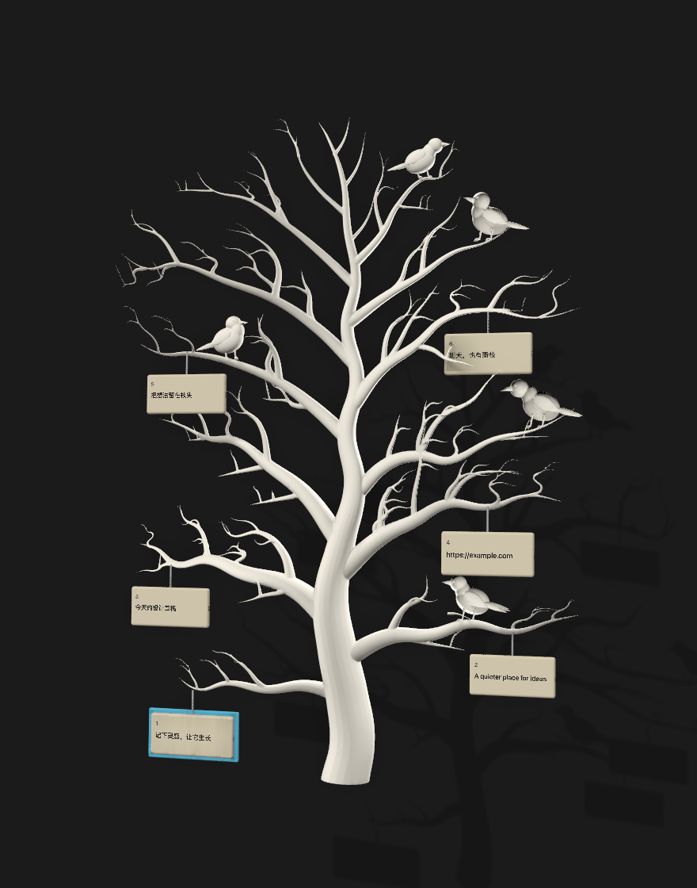
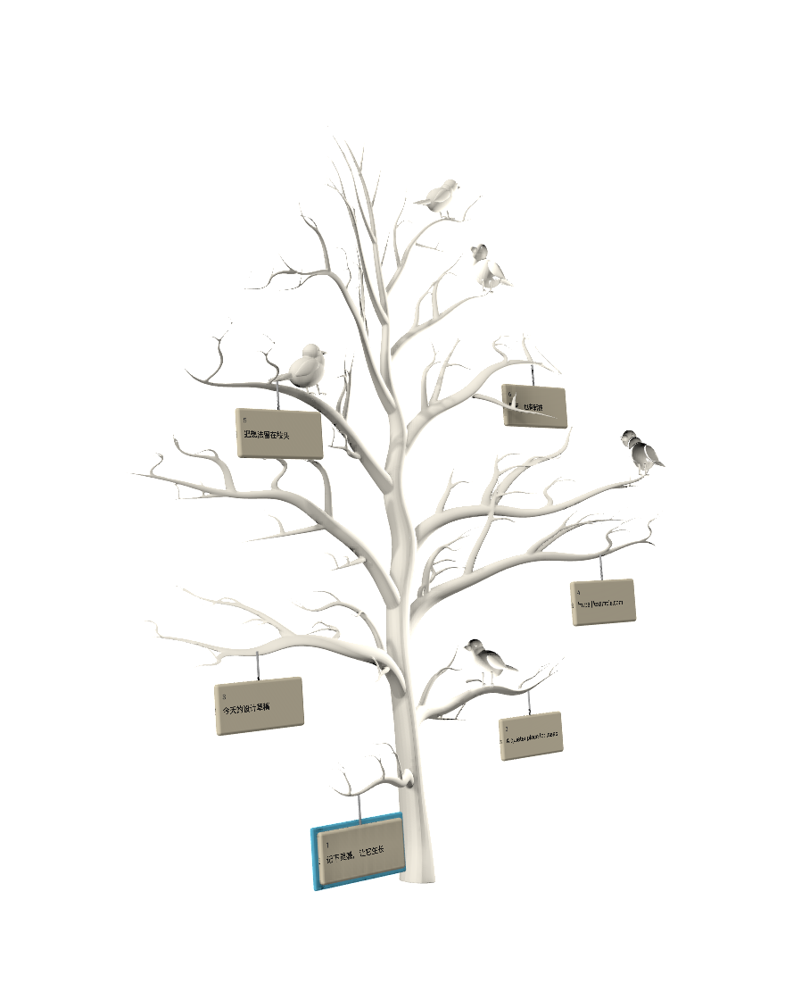

# 3D 许愿树

[文档索引](../README.md) · [用户指南](../../README.md) · [架构](../architecture.md)

应用仅保留许愿树界面，旧版列表偏好不再生效。树与预览共用搜索结果和选中记录。

## 浏览与输入

| 操作 | 行为 |
| --- | --- |
| 输入文字、↑ / ↓ | 筛选、选择；接近加载边界时继续读取历史 |
| Page Up / Page Down（fn↑ / fn↓） | 翻组；快速翻页从当前可见状态接续，不排队 |
| 空格 / ⌘Y / 单击纸签 | 预览当前记录；搜索有文字时也可按空格预览 |
| Shift＋空格 | 在树模式搜索词中插入空格 |
| 回车 / ⌘C | 粘贴 / 仅复制 |
| ⌘1–9 | 按整个结果序列快速粘贴前 9 条，不按当前分组重新编号 |
| ⌘P / Delete | 置顶 / 删除 |
| Esc | 预览打开时先关预览，再按关闭历史；组词和原生拖放优先处理自身取消 |

中文输入法组词期间，空格、导航和确认由输入法处理。完整快捷键见[用户指南](../../README.md#快捷键)。

普通纸签显示摘要与来源，选中后展开更多内容。图片纸签以完整缩略图为主体，保持长宽比；缺图显示占位，不能用 OCR 文字替代。正文与辅助信息采用固定字号，不跟随树布局尺寸缩放。

## 调整布局

日常模式固定树的位置、尺寸和视角。菜单栏「调整树布局…」或面板内 ⇧⌘M 进入调整模式：专用把手移动树，小 / 标准 / 大三档调整尺寸，⌘R 复位，完成或 Esc 退出。每次重新唤起回到日常模式，保留已保存的布局；调整期间纸签不执行浏览或拖放操作。

## 预览与缩放

树模式从选中纸签的挂孔就地展开为同款纸面，接近屏幕边缘时避让，关闭时收回。纸色、圆角、边框、挂孔与元信息共用样式；展开期间隐藏来源纸签，避免重影。

打开时按内容选择 340×210、400×247 或 480×297 的黄金比例逻辑尺寸，同次预览切换记录保持尺寸并跟随挂点。图片首屏展示图片，向下滚动阅读可选择的 OCR 文字；无缩略图时保留占位。

| 行为 | 预览 |
| --- | --- |
| 缩放对象 | 整张纸面，包括边框、文字与图片 |
| 范围 | 松手后回到 100%–200% 内，最大值还受屏幕空间限制；边界有弹性回程 |
| 切换记录 | 保留本轮纸面倍率，保持阅读逻辑尺寸 |
| 关闭后重新打开 | 倍率复位，不持久化 |
| 键盘焦点 | 保持在搜索框 |

树预览无需先点击即可接收窗口内双指缩放。只在预览存活期间安装 local magnify monitor，严格限制到该窗口及其内部坐标；消费一次后不叠加内部滚动视图缩放。关闭时移除监听，不能捕获树体、桌面或其他窗口的手势。诊断日志见[开发文档](../development.md#日志与常见问题)。

### 动效约定

开合、跟随和选择都可打断，连按从当前可见状态继续。动画参数集中在 `Presentation/Animation/`，文档不再复制每个时长或弹簧系数，避免与实现漂移。

- 树从根部向上显现；翻组纸签沿挂点翻转，键盘立即操作当前结果。
- 展开过程中内容随纸面连续放大；结束时不再叠加整窗淡入，切换记录只移动纸面，不额外滑动内部正文。
- 静止后停止动画计时器，离开树视图释放渲染器。
- 系统「减少动态效果」使用短淡入淡出，保留操作反馈。

## 鼠标与原生拖放

装饰树窗口始终 `ignoresMouseEvents = true`。纸签、搜索签、调整控件分别使用受限子窗口；树干、鸟和绳子不参与命中。后方应用的点击由系统原样派发，全局鼠标监视器只观察后收起树，不拦截或回放点击，也不抢回旧应用焦点。

纸签拖动超过 5pt 后进入原生 `NSDraggingSession`。按下时固定记录身份，读取文字、PNG / 图片文件地址或多文件 URL，只允许 copy：不移动树、不移动原文件、不改写系统通用剪贴板、不模拟粘贴。缺失文件整组拒绝；图片导出独立临时副本，避免接收方异步读取受历史删除影响，七天前的导出副本后台清理。

拖放期间保留来源窗口，暂停外部失焦关闭，Esc 交给系统取消。成功投放后关闭树并保留目标焦点；取消后若仍在本应用则保持树与搜索。翻页中可见的纸签暂不执行点击操作，但仍消费点击以免误触后方应用；收起时立即撤走交互窗口，余下淡出只展示画面。

## 模型与预览图

| 正面附近 | 斜侧面 |
| --- | --- |
|  |  |

截图使用虚拟记录，作为视觉参考，不代表最新像素基线。模型源于用户提供的无叶白树参考图，应用版增加枝条纵深。SceneKit 渲染连续树体、5 只鸟、透视相机、侧光和自阴影；AppKit 将纸签绘为朝向读者的平面，细绳连接自动吸附到真实网格表面的挂点。

资源保留 Tree、Bird_01…Bird_05 六个独立组，坐标范围约 6.41 × 8.81 × 2.66。[ivory_tree.scn](../../Sources/PasteHistory/Resources/ivory_tree.scn) 可独立随应用分发；打包脚本把 SwiftPM 资源包放到 `Contents/Resources`，开发运行使用 `Bundle.module`。运行时无需 Blender 或模型网络服务。

## 资源维护

可编辑的 `Ivory_Tree.blend` **不在当前仓库中**。重新导出前需取得制作源文件；只有 `.scn` 时仍可正常构建和验证应用。

1. 在 Blender 打开源文件。树体对象以 `白枝 ·` 开头，五个鸟的姿态控制 Empty 以 `Bird ` 开头。
2. 在 Blender Python 环境执行（也可通过 Blender MCP）；把 `/absolute/repo` 替换为当前仓库绝对路径：

   ```python
   export_path = '/absolute/repo/.build/ivory-export/parts'
   exec(compile(open('/absolute/repo/scripts/export_ivory_tree.py').read(), 'export_ivory_tree.py', 'exec'))
   ```

3. 回到仓库根目录转换资源：

   ```sh
   swift scripts/convert_ivory_tree.swift .build/ivory-export/parts Sources/PasteHistory/Resources/ivory_tree.scn
   ```

导出器使用临时网格，不修改源场景；先按连续函数增加枝条前后错落，鸟按栖息位置整体平移，再降低网格密度。若改此函数或主枝位置，核对 `IvoryTreeSceneView.anchor` 的搜索种子与载入后的表面吸附结果。

## 验证

以下命令从仓库根目录、已登录图形桌面的 macOS 执行。几何冒烟使用生产渲染器和合成记录，不访问用户剪贴板或数据库：

```sh
mkdir -p .build
swiftc -swift-version 5 Sources/PasteHistory/Presentation/Tree/IvoryTreeScene.swift \
  Sources/PasteHistory/Presentation/Tree/IvoryTreePaperView.swift \
  Sources/PasteHistory/Presentation/Windows/HistoryPanel.swift \
  Sources/PasteHistory/Presentation/Tree/TreeInteraction.swift \
  Sources/PasteHistory/Presentation/Style/IvoryPaperStyle.swift \
  Sources/PasteHistory/Presentation/Animation/TreeMotion.swift \
  Sources/PasteHistory/Presentation/Animation/Motion.swift \
  Sources/PasteHistory/Presentation/Animation/MotionClock.swift \
  Sources/PasteHistory/Presentation/Animation/SettlingTrack.swift \
  Sources/PasteHistory/Presentation/Animation/PaperPreviewFlight.swift \
  scripts/test_ivory_tree.swift \
  -o .build/tree-smoke -framework AppKit -framework SceneKit
.build/tree-smoke Sources/PasteHistory/Resources/ivory_tree.scn .build/ivory-preview
```

检查 `.build/ivory-preview/` 中生成的图片，再决定是否更新文档截图。模型更新还需执行 `./scripts/test_tree_ui.sh` 和 `./scripts/build_app.sh`，验证资源装载与真实视图；详细前提见[开发与排障](../development.md#按改动选择验证)。

| 验证范围 | 重点 |
| --- | --- |
| 几何与渲染 | 五只鸟、实际纵深、生长像素变化、纸签命中、装饰窗口忽略拖动、连续翻页和空结果 |
| 业务与输入 | 临时 SQLite、共用选择、复制 / 粘贴回调、置顶 / 删除、搜索 / OCR、分页、IME 与 Esc |
| 预览 | 挂孔锚点、黄金比例、小屏避让、图片占比、OCR 可选择、长文本换条稳定、快速开合和窗口清理 |
| 缩放 | 非 key 窗口、范围排除、监听生命周期、倍率保留 / 复位；另做物理触控板验收 |
| 拖放 | 多行文字、PNG / 导出 URL、多文件、缺失文件拒绝、只复制及取消 |

`./scripts/test_tree_ui.sh --interactive` 保留演示窗口。跨进程拖放人工验收用 `./scripts/test_drag_ui.sh`，图片加 `--drag-image`，文件加 `--drag-files`；拖入独立接收区检查对应 PASS。接收器使用合成数据并验证 copy-only，不修改通用剪贴板。

UI 冒烟验证粘贴回调路由，不模拟向其他应用粘贴。真实输入框回写需另外验证 PasteService，真实双指手势也不能以模拟路由结果代替。
